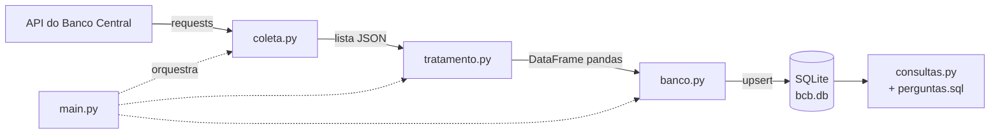
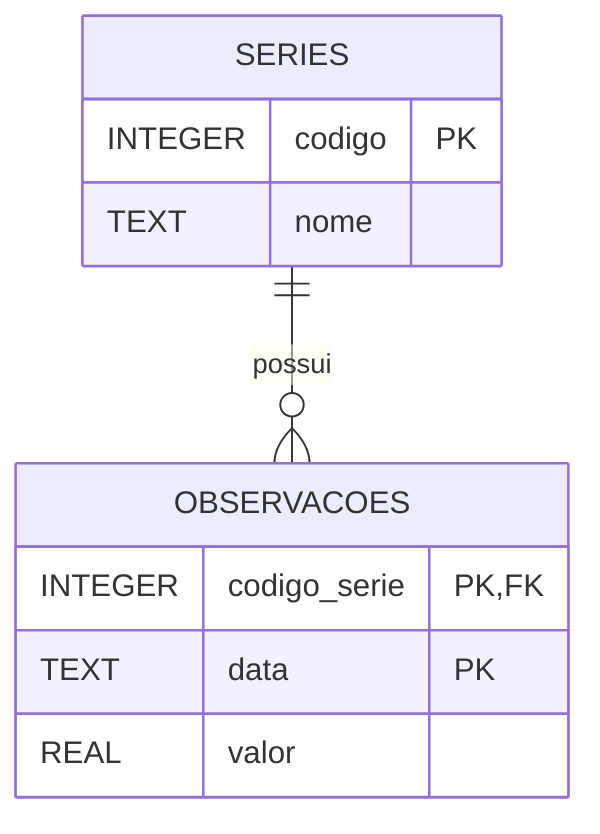

# Coletor de Dados do Banco Central

Pipeline de dados em Python que **coleta** séries econômicas da API pública do Banco Central do Brasil,
**trata** os dados com pandas, **armazena** em um banco SQLite e **responde perguntas** com SQL.

O projeto atualiza os dados de forma incremental, tenta de novo automaticamente em caso de falha da API
e registra cada execução em arquivo de log.

---

## Séries coletadas

| Código SGS | Indicador | Frequência | Período |
|---|---|---|---|
| 1 | Dólar comercial (venda) – R$ | Diária (dias úteis) | 2015 até hoje |
| 432 | Meta da taxa Selic – % ao ano | Diária | 2015 até hoje |
| 433 | IPCA – variação mensal (%) | Mensal | 2015 até hoje |

Fonte: [API SGS do Banco Central do Brasil](https://dadosabertos.bcb.gov.br/)

---

## Arquitetura



| Arquivo | Responsabilidade |
|---|---|
| `coleta.py` | Consulta a API, divide períodos longos em blocos e trata falhas com novas tentativas |
| `tratamento.py` | Converte tipos, remove inválidos e duplicados e padroniza a tabela |
| `banco.py` | Cria o banco, grava os dados com *upsert* e consulta a última data salva |
| `main.py` | Orquestra o pipeline, configura os logs e decide o período a coletar |
| `sql/perguntas.sql` | Perguntas de negócio respondidas em SQL |
| `consultas.py` | Executa as perguntas e exibe os resultados |

### Modelo do banco



---

## Decisões técnicas

- **Limite de 10 anos da API:** a API do BC aceita no máximo 10 anos por consulta; o período é dividido em blocos de até 5 anos.
- **Novas tentativas automáticas:** erros temporários (timeout, falha de conexão, erros 5xx) são repetidos até 3 vezes, com espera crescente. Erros 4xx não são repetidos.
- **Upsert:** a chave primária `(codigo_serie, data)` com `ON CONFLICT DO UPDATE` permite rodar o pipeline várias vezes sem duplicar dados e corrige valores revisados pelo BC.
- **Atualização incremental:** cada execução coleta apenas a partir da última data gravada, com margem de 60 dias para capturar revisões. A opção `--completo` recoleta todo o histórico.
- **Datas no formato ISO (`AAAA-MM-DD`):** como o SQLite não tem tipo de data, esse formato mantém a ordenação cronológica e permite usar `strftime`.
- **Consultas parametrizadas (`?`):** evitam *SQL injection*.
- **Logs:** cada execução é registrada com data, hora e nível em `logs/pipeline.log`.

---

## Perguntas respondidas com SQL

| # | Pergunta | Recurso de SQL |
|---|---|---|
| 1 | Quantos registros e qual o período de cada série? | `JOIN`, `GROUP BY` |
| 2 | Cotação média, mínima e máxima do dólar por ano | `strftime`, funções de agregação |
| 3 | Dias de maior e menor cotação do dólar | Subconsulta, `UNION ALL` |
| 4 | Variação % do dólar em cada ano | CTE, *self-join* |
| 5 | Os 5 meses de maior inflação | `ORDER BY`, `LIMIT` |
| 6 | Meses com deflação por ano | `CASE WHEN` |
| 7 | Datas em que a meta Selic mudou | Função de janela `LAG()` |
| 8 | Dólar, Selic e deflação lado a lado por ano | Múltiplas CTEs, `LEFT JOIN` |

As consultas completas estão em [`sql/perguntas.sql`](sql/perguntas.sql).

### Alguns resultados

- **Maior cotação do dólar no período:** R$ 6,2086 em 02/01/2025.
- **Menor cotação do dólar no período:** R$ 2,5754 em 22/01/2015.
- **Maior alta anual do dólar:** +45,00% em 2015 (de R$ 2,6929 para R$ 3,9048).
- **Maior IPCA mensal:** 1,62% em março de 2022.
- **Ano com mais meses de deflação:** 2022, com 3 meses de IPCA negativo.
- **Mudanças da meta Selic:** 57 decisões (24 altas e 33 cortes), com a taxa variando entre 2,00% e 15,00% ao ano.

### Visão anual (resultado da pergunta 8)

| Ano | Dólar médio (R$) | Selic média (% a.a.) | Meses com deflação |
|---|---|---|---|
| 2015 | 3,3387 | 13,47 | 0 |
| 2016 | 3,4833 | 14,18 | 0 |
| 2017 | 3,1925 | 10,15 | 1 |
| 2018 | 3,6558 | 6,58 | 2 |
| 2019 | 3,9461 | 6,04 | 1 |
| 2020 | 5,1578 | 2,89 | 2 |
| 2021 | 5,3956 | 4,54 | 0 |
| 2022 | 5,1655 | 12,55 | 3 |
| 2023 | 4,9953 | 13,30 | 1 |
| 2024 | 5,3920 | 10,94 | 1 |
| 2025 | 5,5855 | 14,42 | 1 |
| 2026* | 5,1411 | 14,46 | 1 |

\* 2026 parcial: dólar e Selic até outubro; IPCA até setembro.

*Dados de 01/01/2015 até a última atualização do banco, em 22/10/2026 (dólar até 21/10/2026; IPCA até setembro de 2026).*

---

## Como executar

**Pré-requisito:** Python 3.10 ou superior.

```bash
# 1. Clonar o repositório
git clone https://github.com/LuisFelipeGatti/Coletor-Dados-BCB.git
cd Coletor-Dados-BCB

# 2. Criar e ativar o ambiente virtual
python -m venv venv
venv\Scripts\activate          # Windows
# source venv/bin/activate     # Linux / macOS

# 3. Instalar as dependências
pip install -r requirements.txt

# 4. Rodar o pipeline (a primeira execução coleta todo o histórico)
python main.py

# 5. Ver as respostas das perguntas
python consultas.py
```

Para recoletar todo o histórico a qualquer momento:

```bash
python main.py --completo
```

---

## Estrutura do projeto

```
Coletor-Dados-BCB/
├── sql/
│   └── perguntas.sql
├── banco.py
├── coleta.py
├── consultas.py
├── main.py
├── tratamento.py
├── requirements.txt
└── README.md
```

As pastas `dados/` (banco) e `logs/` são criadas automaticamente na primeira execução.

---

## Tecnologias

- **Python** (requests, pandas, sqlite3, logging, argparse)
- **SQL** (SQLite: CTEs, funções de janela, *upsert*)
- **Git e GitHub**

---

## Próximos passos

- [ ] Agendar a execução diária com GitHub Actions
- [ ] Criar um painel interativo com Streamlit
- [ ] Adicionar testes automatizados com pytest
- [ ] Incluir novas séries (por exemplo, IGP-M e taxa de desemprego)

---

## Autor

**Luis Felipe Gatti**
Estudante de Análise e Desenvolvimento de Sistemas – Fatec Lins

[LinkedIn](https://www.linkedin.com/in/luis-felipe-gatti-153aa3364/) · [GitHub](https://github.com/LuisFelipeGatti)

